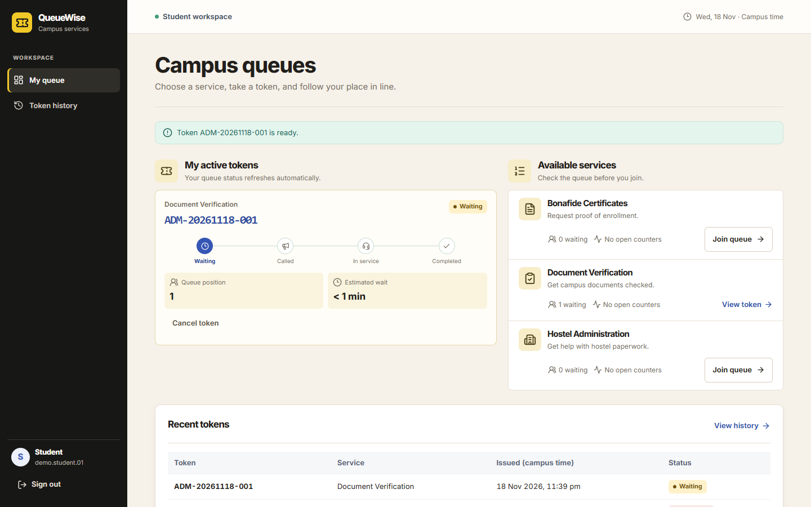
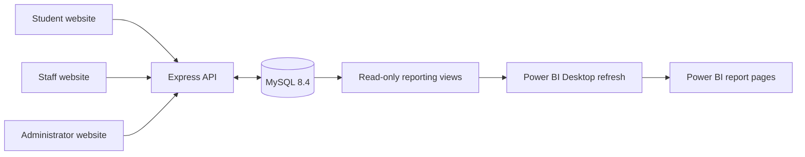

# QueueWise

### Campus queues, from token to service



React · Express · MySQL · Docker · Power BI Desktop

[Run locally](#run-locally) · [How it works](#how-queuewise-works) · [Power BI](#power-bi-desktop) · [Demonstration](#demonstration) · [Testing](#testing) · [Repository map](#repository-map)

QueueWise is a web app for campus service desks. Students take a token online, see where they are in line, and learn which counter to visit. Staff serve the next eligible token. Administrators manage services, counters, and staff assignments.

- **Student** — Join a service, track the token and estimated wait, cancel while waiting, or view history. The student workspace also works on mobile.
- **Staff** — Open an assigned counter, call the next token, start and complete service, or record a skip or no-show.
- **Admin** — Add services and counters, assign staff, pause or resume intake, and monitor activity. Already issued tokens stay in the queue when intake pauses.
- **Analyst** — Use the separate Power BI Desktop report to review demand, waits, and counter workload.

Student and staff needs carry equal weight. Show students their status, counter and next step, and show staff the current token and next action. Use plain campus terms consistently, keep development fixtures out of the user-facing experience, and label estimated waits and imported reporting snapshots clearly.

## Run locally

Install Docker Desktop with Compose and start its engine. Run the commands below from the repository root.

1. Install Docker Desktop with Compose. Copy `.env.example` to `.env` and set `MYSQL_PASSWORD` and `MYSQL_ROOT_PASSWORD` to separate values.
2. From this folder run:

   ```sh
   docker compose up -d --build --wait
   ```

3. Open <http://localhost:8080>. Check <http://localhost:8080/api/health> if the page does not load.
4. For a new database, create an administrator account and save the password shown:

   ```sh
   docker compose exec app node backend/src/create-user.js ADMIN admin --generate-password
   ```

5. Sign in as `admin`. Add services and counters. Create an account for each student and staff member, then assign staff to counters:

   ```sh
   docker compose exec app node backend/src/create-user.js STUDENT student001 --generate-password
   docker compose exec app node backend/src/create-user.js STAFF staff001 --generate-password
   ```

Each person should get their own login and password. For an interactive password prompt, omit `--generate-password` and run the command from a terminal. Account creation requires local server access; the public website has no self-registration.

To reset an existing account password, run `docker compose exec app node backend/src/reset-password.js admin` and enter the new password twice. Replace `admin` with the login of any student or staff member. The account's existing sessions are signed out.

Use `docker compose down` to stop the app and retain MySQL data. Adding `-v` removes the database volume and its data.

## Configuration and development

| Setting | Default or requirement |
| --- | --- |
| `MYSQL_PASSWORD` | Required application database password |
| `MYSQL_ROOT_PASSWORD` | Required for initializing Docker MySQL |
| `MYSQL_DATABASE` / `MYSQL_USER` | `queuewise` / `queuewise` |
| `MYSQL_HOST` / `MYSQL_PORT` | `127.0.0.1` / `3307` for direct development |
| `APP_PORT` | `8080` for the packaged website |
| `API_HOST` / `API_PORT` | `127.0.0.1` / `3000` for direct development |

Compose uses the internal hostname `db` and database port `3306`. Website accounts have their own passwords.

Copy the configuration with `cp .env.example .env` in Bash, or `Copy-Item .env.example .env` in PowerShell. Keep the real `.env` private. On an existing installation, retain the database passwords used to initialize its volume.

Set `MYSQL_PASSWORD` and `MYSQL_ROOT_PASSWORD` in the local `.env` file. Default host ports are `APP_PORT=8080` and `MYSQL_PORT=3307`. The app and MySQL communicate on the Compose network. See [.env.example](.env.example) for the connection settings.

For frontend development, install Node.js 24 and use the [database setup](docs/database.md) to start MySQL and apply migrations. Run `npm ci --prefix backend` and `npm ci --prefix frontend`. In separate terminals run `npm --prefix backend start` and `npm --prefix frontend run dev`. Open the URL Vite prints. Vite proxies API calls to the Express port configured by `API_PORT`.

## How QueueWise works

[System design](SYSTEM_DESIGN.svg) · [Database design](DATABASE_DESIGN.svg)

The frontend uses React, Vite, Tailwind CSS and Lucide icons. The Express API runs on Node.js 24 and stores data in MySQL 8.4. The website polls the API for live updates. Power BI reads MySQL reporting views when refreshed.



1. An administrator adds a service and counter and assigns a staff account to the counter.
2. Staff opens the counter. MySQL records the open interval.
3. A student selects **Join queue**. The API creates a queue session if needed, issues the next sequence, stores a `WAITING` token, and records the issuance event in one database transaction.
4. Staff selects **Call next token**. The oldest eligible waiting token becomes `CALLED`, with the counter and call time recorded. The student's page refreshes automatically.
5. Staff starts and completes the visit. The token becomes `IN_SERVICE`, then `COMPLETED`. Each transition has a lifecycle event and timestamp.
6. MySQL reporting views calculate wait, handling, hourly demand, daily summaries, and counter staffed time from those records. Power BI reads the views on its next refresh.

Token numbers contain the service code, campus date, and daily sequence. The website updates its live views by polling the API. Queue changes use database transactions and locking so concurrent counters do not take the same token.

Use the website or API for normal queue activity. SQL writes made directly in MySQL must satisfy the schema and supply the queue session, actor, lifecycle events and timestamps. Event timestamps are stored in UTC. Token numbers and reporting dates use campus time in Asia/Kolkata. A wait estimate depends on counter availability and service durations and may be unavailable.

## What MySQL stores

| Table | Meaning |
| --- | --- |
| `users` and `auth_sessions` | Account roles, password hashes, and sign-in sessions. |
| `services` and `counters` | Services students can join and physical desks where staff serve them. |
| `staff_assignments` | Which staff member can operate each counter. |
| `queue_sessions` | The daily sequence for each service. |
| `tokens` | Current token state, student, service, counter, and lifecycle timestamps. |
| `token_events` | Audit trail of each state change and its actor. |
| `counter_availability` | When counters opened and closed for workload calculations. |

The migrations define constraints that protect the relationships and legal token states. Reporting views such as `vw_token_lifecycle` and `vw_counter_performance` turn operational rows into data that Power BI can import. The reporting account has access to those views, without direct access to `users` or `auth_sessions`.

## Power BI Desktop

Open [QueueWise-Manual.pbix](analytics/powerbi/QueueWise-Manual.pbix) in Power BI Desktop on Windows. This is the standalone academic report. Install the MySQL Connector/NET if required. Start QueueWise and use **Home → Refresh** to import updated data. If the server or database name differs from the file's saved source, update it in Power Query. The default local connection is `127.0.0.1:3307` with database `queuewise`, subject to your local configuration.

### Prepare the reporting account

Select the QueueWise database in MySQL and run [reader.sql](database/reporting/reader.sql) as a database administrator. Save the generated password privately. Use `queuewise_bi` for the Power BI connection. The account can read the reporting views only.

| Page | Main question |
| --- | --- |
| Operations Overview | How many tokens were issued and completed, and what was the average wait? |
| Counter Efficiency | How many visits did each desk complete, and how much staffed time was busy? |

Wait time runs from issuance to first call. Service duration runs from service start to completion. A token still waiting has no measured wait yet. Power BI uses campus-local dates so its daily charts match the date shown on token numbers.

### Verify a report number

Clear report filters, or apply the same dates and services in SQL. Compare the total and completed token cards with:

```sql
SELECT COUNT(*) AS total_tokens,
       COUNT(CASE WHEN status = 'COMPLETED' THEN 1 END) AS completed_tokens
FROM vw_token_lifecycle;
```

For Counter Efficiency, compare the displayed counter results with `vw_counter_performance`, using the same date range. Keep the [reporting checks](analytics/validation/reporting.sql) and [wait estimate diagnostic](analytics/validation/eta_accuracy.sql) as evaluation evidence. Power BI Desktop rendering and refresh still need verification.

## Demonstration

Create a service and counter in Operations. Assign a staff account. Have a student join the queue, then have staff call, start and complete the token. Check the student's history and the live Operations totals. Refresh the separate Power BI report to see the recorded activity. Follow the [live demo script](docs/demo.md) for local demo credentials, step-by-step narration, database queries, and panel questions. Use separate browser profiles for each role. Tabs in the same profile share a session. The [prepared scenario](docs/showcase-scenario.md) records the earlier fictional campus walkthrough.

## Testing

From the project root, with Node.js 24 and npm installed:

```sh
npm ci --prefix backend
npm ci --prefix frontend
npm --prefix backend test
npm --prefix frontend run build
```

For MySQL integration tests, use a disposable database with a name ending in `_test`. Follow the [API test instructions](docs/backend.md#verify-the-api) and the [browser smoke test guide](#browser-smoke-test). CI also runs SQL constraint and reporting checks.

### Browser smoke test

Start QueueWise against a disposable database populated with the demo seed. The test completes and cancels real tokens and creates a uniquely named service and counter. It pauses its service when finished, and restores the demo counter assignment and staffing state after a successful run.

Run from the repository root with Node.js 24 or newer.

```sh
npm ci --prefix tests/e2e
npm --prefix tests/e2e run install:chromium
npm --prefix tests/e2e test
```

Set `DEMO_PASSWORD` in the test process to the password used to generate the demo account hash. The test opens `http://127.0.0.1:8080` by default. Set `QUEUEWISE_E2E_URL` for a different running instance. To use an installed Chrome instead of downloading Playwright Chromium, provide its absolute executable path in `CHROME_PATH` and skip the browser installation command.

## Repository map

| Location | What it contains |
| --- | --- |
| [frontend](frontend) | Role workspaces and shared UI |
| [backend](backend) | Queue rules, authentication, wait estimates and API tests |
| [database](database) | MySQL migrations, permissions and SQL fixtures |
| [analytics](analytics) | Standalone Power BI report and SQL verification |
| [tests/e2e](tests/e2e) | Browser walkthrough for all three roles |
| [Docker Compose](docker-compose.yml) | Local app, MySQL and migration runner |
| [CI workflow](.github/workflows/ci.yml) | Automated verification |
| [docs](docs) | Project guides, technical references and evaluation evidence |

## Documentation

- [Live demonstration and panel questions](docs/demo.md)
- [Presentation speaking script](docs/presentation-script.md)
- [Evaluation presentation](submission/Presentation.pptx)

- [System architecture](docs/system-architecture.md)
- [Backend API](docs/backend.md)
- [MySQL setup and data model](docs/database.md)
- [Compliance report](docs/final-compliance-report.md)
- [Testing evidence](docs/testing-report.md)
- [Project contributions and attribution](docs/project-contributions.md)

## Academic project

**Course** · Tools and Practice for Data Science  
**Institution** · Indian Institute of Information Technology Nagpur  
**Team** · Sayan Majhi (BT24CSD028) and Piyush Manglam (BT24CSD032)  
**Faculty guide** · Prof. Santosh Kumar Sahu

The demonstration uses fictional campus records. Campus observations are needed to assess wait-estimate accuracy. Hosted deployment and full accessibility verification remain unverified. The [contribution record](docs/project-contributions.md) credits the libraries, supplied image, reference design, and Codex assistance used in the project.
