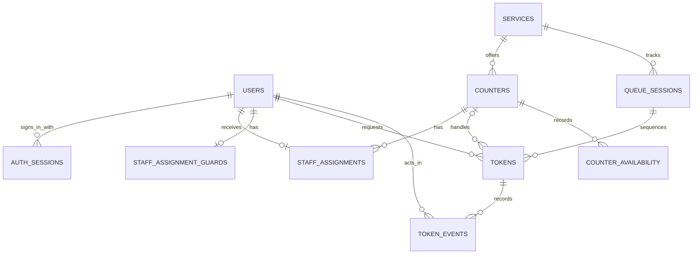

# QueueWise MySQL setup and verification

## Start and migrate

The [full-stack Compose setup](../README.md#run-locally) starts MySQL 8.4, runs migrations in a one-time container, and starts the application. The host MySQL port defaults to 3307 and is bound to loopback. Containers communicate with MySQL over the Compose network on port 3306.

For development with a local Node.js backend, start only the database and run the migration command from the project root.

```sh
docker compose up -d --wait db
npm --prefix backend ci
npm --prefix backend run db:migrate
```

To use another MySQL 8.4 server, create an empty database and an account with privileges to migrate it. Set `MYSQL_HOST`, `MYSQL_PORT`, `MYSQL_DATABASE`, `MYSQL_USER`, and `MYSQL_PASSWORD` in `.env` before running the migration command. With Compose, choose a separate `MYSQL_ROOT_PASSWORD` for database administration.

The runner takes a database-specific named lock, applies numbered SQL files, and records successful versions in `queuewise_schema_migrations`. MySQL commits schema changes implicitly. The migration statements can run again if a failure occurs before a version is recorded.

## Data model



- Each queue session belongs to one service and local calendar date. Services can have multiple counters. Composite foreign keys ensure a token's queue session and assigned counter belong to its service.
- Each staff account can be assigned to one counter. A counter may have multiple staff accounts.
- Generated nullable keys and unique indexes enforce one active token per student and service, one active token per counter, and one open staffing interval per counter.
- Queue operations lock the service row before reading or changing its queue. The token transition and its event commit together. A failed event write rolls back the transition.
- Operational timestamps are UTC with microsecond precision. Queue numbering and reporting use campus time, UTC+05:30. The waiting order retains older open tickets when a new campus day starts.
- Reporting views expose token timing, service demand, and staffed and busy time. The dedicated reporting login reads those views. See [Power BI reader setup](../README.md#prepare-the-reporting-account).

## Create accounts and services

After migration, create an administrator account with `docker compose exec app node backend/src/create-user.js ADMIN admin --generate-password` and save the generated password. Sign in to add services and counters. Create each student and staff login with the same command and its corresponding role. Assign staff in the administrator workspace. The new database starts with no services, tokens, or report activity.

## Verify MySQL and reporting

Run integrity checks on a disposable migrated database. Run reporting comparisons against real queue activity after a Power BI refresh. For a disposable Compose instance, use these commands from the project root in Bash.

```sh
dbsql() {
  docker compose exec -T db sh -c 'MYSQL_PWD="$MYSQL_PASSWORD" exec mysql -u "$MYSQL_USER" "$MYSQL_DATABASE"'
}

dbsql < database/tests/constraints.sql
dbsql < analytics/validation/eta_accuracy.sql
```

The constraint script exercises the schema's integrity rules. The ETA report compares saved issuance estimates with time to first call for any selected database. It returns coverage, mean absolute error, and signed bias by service and estimate basis. The repository's CI also runs isolated fixture checks in a disposable database.
