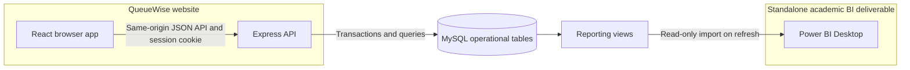
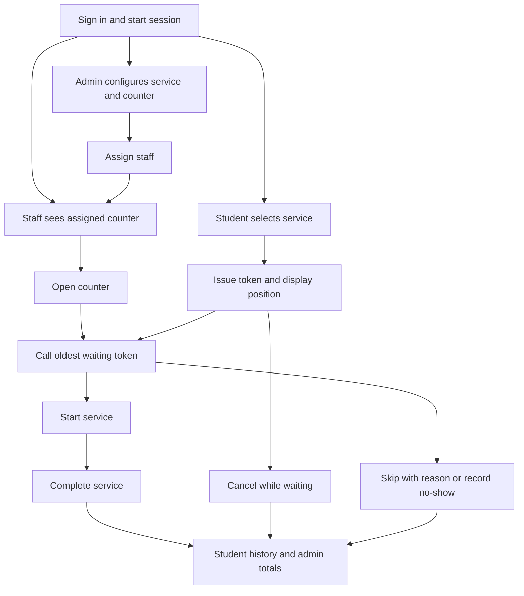
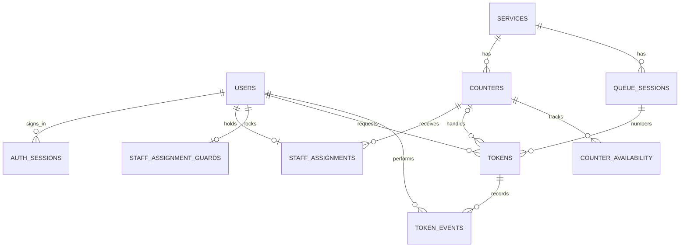

# QueueWise system architecture

Docker Compose runs MySQL, a migration job, and the application. The application serves the built frontend and API from the same origin. In development, Vite serves the frontend and proxies API requests to Express. The browser never connects directly to MySQL. Power BI reads reporting views through a separate database reader.

## Role workflows

## Operational data relationships

The [MySQL migrations](../database/migrations) define constraints and derived views. Composite foreign keys keep the counter and queue session on the token's service. Generated unique keys enforce one active token per student and service and one active token per counter.

| Component | Responsibility |
|---|---|
| [Frontend](../frontend/src) | Role navigation, queue polling, forms and action feedback. |
| [Express API](../backend/src) | Resolve sessions, enforce roles and assignments, validate requests, and apply transitions. |
| [Queue transactions](../backend/src/queue.js) | Serialize writes on the service row. Commit a token change and its event together. |
| [Reporting views](../database/migrations/003_reporting.sql) | Produce campus-local date buckets and calculate elapsed wait, handling and staffed time. |
| [Power BI project](../analytics/powerbi/QueueWise-Manual.pbix) | Import and summarize lifecycle and counter data in two report pages. |

Operational timestamps are UTC. The queue date and report day buckets use campus time (UTC+05:30). The reporting import is a snapshot that changes on refresh.
